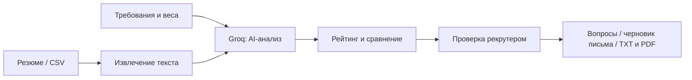

<div align="center">

# Resume Screener
### AI-помощник для первичного разбора резюме

**Python · Streamlit · Groq · PDF / DOCX / TXT / RTF / CSV**

[Быстрый старт](#быстрый-старт) · [Демонстрация](docs/DEMO.md) · [Архитектура](docs/ARCHITECTURE.md) · [Безопасность](SECURITY.md)

</div>

## Задача и ценность

При первичном отборе рекрутеру нужно сопоставить разные резюме с одними требованиями, выделить пробелы и подготовить вопросы для интервью. Resume Screener объединяет эти шаги в одном веб-интерфейсе: загружает документы, формирует AI-оценку, показывает сравнение кандидатов и готовит материалы для дальнейшего разговора.

Проект демонстрирует разработку прикладного AI-инструмента для HR: обработку документов, структурированные ответы LLM, пакетный анализ и экспорт отчётов. Это прототип для демонстрации и дальнейшей адаптации под процесс заказчика. Решение о найме принимает человек; точность и экономия времени в этом репозитории не измерены.

## Реализованные функции

| Этап | Что есть в коде |
| --- | --- |
| Загрузка | PDF с текстовым слоем, DOCX, TXT, RTF; накопление файлов в сессии, удаление отдельных файлов; лимит 100 файлов |
| CSV | Выбор колонок с именем и текстом резюме; анализ первых 100 строк |
| Требования вакансии | Должность, опыт в годах и месяцах, навыки; расширенные настройки образования, языка, отрасли, формата занятости и дополнительных требований |
| Оценка | Общая оценка 0–100, отдельные оценки опыта, технических навыков, образования и soft skills; настраиваемые веса, сильные стороны, пробелы и рекомендация |
| Просмотр | Top 5 / 10 / 15, фильтры по оценке и минимальным требованиям, сортировка, сравнение 2–3 кандидатов |
| Интервью | Генерация пяти вопросов по выявленным пробелам и двух вопросов для проверки утверждений из резюме |
| Коммуникация | Редактируемый черновик приглашения, запроса дополнительных сведений или отказа; копирование текста, без отправки писем |
| Отчёт | Индивидуальный отчёт TXT и PDF, включая вопросы, если они уже сгенерированы |

Лимиты файлов и CSV применяются отдельно: при одновременном вводе оба источника объединяются. Название кандидата для файла берётся из имени файла.

## Как проходит работа



## Технологический стек

- **Python, Streamlit** — приложение и состояние пользовательской сессии.
- **Groq SDK**, модель `llama-3.3-70b-versatile` — анализ, вопросы и черновики писем.
- **pdfplumber, python-docx, striprtf** — извлечение текста; **pandas** — чтение CSV.
- **ReportLab** — PDF-отчёты; **python-dotenv** — локальная конфигурация.

Зависимости перечислены в [requirements.txt](resume_screener/requirements.txt). База данных, ATS-интеграция и авторизация в текущем коде отсутствуют.

## Быстрый старт

Нужны Python **3.12+**, доступ в интернет и собственный ключ Groq. Выбор Python связан с синтаксисом вложенных f-строк в текущем `app.py`; синтаксис проверен на Python 3.14, полный запуск в этой проверке не выполнялся.

```bash
git clone https://github.com/tairasset/hr_automation.git
cd hr_automation
python -m venv .venv
```

Активируйте окружение:

| Система | Команда |
| --- | --- |
| Windows PowerShell | `.venv\Scripts\Activate.ps1` |
| macOS / Linux | `source .venv/bin/activate` |

```bash
python -m pip install -r resume_screener/requirements.txt
```

Скопируйте [`.env.example`](.env.example) в `.env` в корне репозитория и заполните `GROQ_API_KEY`. Этот файл должен оставаться локальным.

```bash
python -m streamlit run resume_screener/app.py --server.address 127.0.0.1
```

Откройте адрес из терминала, обычно `http://localhost:8501`. Начните с [синтетического CSV](examples/candidates.csv) и [сценария демонстрации](docs/DEMO.md).

**Codespaces / Dev Container:** существующая конфигурация использует Python 3.11, устанавливает только Streamlit при отсутствии корневого requirements.txt и отключает CORS/XSRF. Она не является готовой инструкцией безопасного запуска; используйте команды выше с Python 3.12+ и полной установкой зависимостей.

## Ограничения, которые важно знать

- OCR отсутствует: сканированный PDF без текстового слоя не будет прочитан.
- Для первичной оценки отправляются первые 5 000 символов очищенного резюме и 3 000 символов вакансии; для вопросов — 3 000 и 2 000 соответственно. Конец длинного документа может не попасть в анализ.
- Анализ идёт последовательно с паузами между кандидатами и повторными попытками при ограничениях API. Доступность модели, квоты и стоимость зависят от провайдера.
- Оценки и рекомендации генерирует модель. Код ограничивает диапазоны, но не проверяет равенство общей оценки сумме категорий.
- После неудачных попыток возвращается **0 / No Hire** с предупреждением в summary. Это ошибка анализа, а не доказательство слабой квалификации. Повторные запросы после ошибки разбора также теряют исходный контекст кандидата.
- Файлы различаются по имени, а детали и вопросы — по имени кандидата. Используйте уникальные имена, чтобы избежать смешения данных.
- Состояние хранится в Streamlit-сессии, без постоянного хранилища. Перезагрузка/завершение сессии может его потерять; кнопка New Analysis не гарантирует полную очистку всех состояний виджетов.
- Черновик отказа может утверждать, что вакансия уже закрыта: проверьте факты и текст перед использованием.
- PDF использует системный Unicode-шрифт, если он найден; без него возможны проблемы с кириллицей.

## Безопасность и развитие под заказчика

Резюме, требования и данные кандидата отправляются в Groq для обработки. Для демонстраций используйте синтетические данные. Перед работой с реальными кандидатами нужны согласованные правила обработки данных, контроль доступа и проверка качества AI-оценки. Подробности и результаты ограниченной проверки файлов — в [SECURITY.md](SECURITY.md).

Возможные направления адаптации: интеграция с ATS, постоянное хранилище, роли доступа, отдельный статус ошибки анализа и проверка качества на согласованной выборке. Это будущая работа, а не готовые функции.

## Материалы и связь

- [Демонстрация и проверка](docs/DEMO.md)
- [Архитектура и карта исходников](docs/ARCHITECTURE.md)
- [Безопасность](SECURITY.md)
- Второй проект: [Oracle — прототип финансовой аналитики](https://github.com/tairasset/Oracle-service)

Для обсуждения адаптации проекта: [профиль автора](https://github.com/tairasset). Файл LICENSE отсутствует; условия использования и передачи кода следует согласовать отдельно.
